<a href="https://www.mhbd.dev">
  <picture>
    <source media="(prefers-color-scheme: dark)" srcset="assets/hero-dark.svg">
    
  </picture>
</a>

  <a href="https://www.mhbd.dev">mhbd.dev</a> &nbsp;·&nbsp;
  <a href="https://www.linkedin.com/in/muhammed-bodruk-84625a356/">LinkedIn</a> &nbsp;·&nbsp;
  <a href="https://x.com/MBodruk3049">X</a> &nbsp;·&nbsp;
  <a href="mailto:mhbd@mhbd.dev">mhbd@mhbd.dev</a>

I've been shipping production apps for 8+ years. I turn fast AI experiments into durable products — type-safe architecture, resilient data models and calm interfaces.

### 01&nbsp; Selected work

<table>
<tr>
<td width="50%" valign="top">

**[KAFL Nexus](https://kafl.mhbd.dev)** &nbsp;2025 – now 
PRODUCT DEVELOPER · EDUCATION ANALYTICS & AI

Turns exam-result PDFs into structured student, class and institution data, then into dashboards and AI guidance reports. Fuzzy matching untangles inconsistent names.

`Next.js` `PostgreSQL` `Drizzle ORM` `PDF parsing`

</td>
<td width="50%" valign="top">

**[Atafen Eğitim Kurumu](https://atafenegitim.com)** &nbsp;2026 – now 
FREELANCE FULL-STACK DEVELOPER

Institutional CMS for programs, announcements and contact content, built end to end: type-safe data model, auth, and a publishing flow non-technical staff can run.

`Next.js` `TypeScript` `PostgreSQL` `Tailwind CSS`

</td>
</tr>
<tr>
<td valign="top">

**[M4X Esport](https://m4x.mhbd.dev)** &nbsp;2026 
FULL-STACK PLATFORM

Tournaments, scrims, team registration, standings and sponsor visibility in one operations panel, behind protected admin workflows.

`Next.js` `TypeScript` `Drizzle ORM` `JWT`

</td>
<td valign="top">

**[Neoesis](https://neoesis.mhbd.dev)** &nbsp;2025 – 2026 · [repo](https://github.com/MHBDMuhammed/Neoesis) 
AI-ASSISTED LEARNING PLATFORM

Explanation, interactive modules and assessment in one system, with reusable lesson templates, agent-based content workflows and quality checks.

`Next.js` `Three.js` `Zustand` `Agentic workflows`

</td>
</tr>
</table>

### 02&nbsp; How I build

<picture>
  <source media="(prefers-color-scheme: dark)" srcset="assets/loop-dark.svg">
  
</picture>

AI agents speed up implementation; architecture, data modeling, security boundaries and release quality stay human decisions. 
Claude Code · Codex CLI · OpenCode · MCP · Custom Skills

### 03&nbsp; Stack

**Foundation** &nbsp; TypeScript · Next.js · React · Tailwind CSS · UI/UX 
**Systems** &nbsp; Node.js · PostgreSQL · Drizzle ORM · REST · Auth 
**AI** &nbsp; LLM APIs · Vercel AI SDK · Structured Outputs · Tool Calling · Python 
**Shipped** &nbsp; Docker · GitHub Actions · Vercel

Open to web projects — <a href="mailto:mhbd@mhbd.dev">mhbd@mhbd.dev</a>

